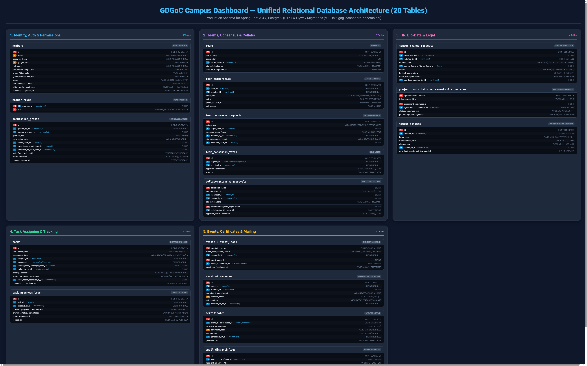

# Entity Relationship Diagram (ERD) — GDGoC Campus Dashboard

The backend relational schema consists of **20 tables** grouped into 5 functional modules:
1. **Identity, Auth & Access Sharing** (`members`, `member_roles`, `permission_grants`)
2. **Team Management & Consensus** (`teams`, `team_memberships`, `team_consensus_requests`, `team_consensus_votes`, `collaborations`, `collaboration_team_approvals`)
3. **HR, Bio-Data & Legal Agreements** (`member_change_requests`, `project_contributor_agreements`, `agreement_signatures`, `member_letters`)
4. **Task Assigning & Tracking Core** (`tasks`, `task_progress_logs`)
5. **Events, Certificates & Mailing** (`events`, `event_leads`, `event_attendances`, `certificates`, `email_dispatch_logs`)

## Visual Architecture Diagram

---

## 1. Complete Mermaid ERD

```mermaid
erDiagram

    MEMBERS ||--o{ MEMBER_ROLES : "has"
    MEMBERS ||--o{ TEAM_MEMBERSHIPS : "joins"
    TEAMS ||--o{ TEAM_MEMBERSHIPS : "contains"
    TEAMS ||--o{ TEAMS : "parent_team_of"

    MEMBERS ||--o{ TEAM_CONSENSUS_REQUESTS : "initiates"
    TEAMS ||--o{ TEAM_CONSENSUS_REQUESTS : "target_team"
    TEAM_CONSENSUS_REQUESTS ||--o{ TEAM_CONSENSUS_VOTES : "has"
    MEMBERS ||--o{ TEAM_CONSENSUS_VOTES : "casts_vote"

    MEMBERS ||--o{ PERMISSION_GRANTS : "grants"
    MEMBERS ||--o{ PERMISSION_GRANTS : "receives"
    TEAMS ||--o{ PERMISSION_GRANTS : "scope_team"

    MEMBERS ||--o{ MEMBER_CHANGE_REQUESTS : "subject_of"
    MEMBERS ||--o{ MEMBER_CHANGE_REQUESTS : "initiated_by"
    TEAMS ||--o{ MEMBER_CHANGE_REQUESTS : "current_team"
    TEAMS ||--o{ MEMBER_CHANGE_REQUESTS : "target_team"

    TEAMS ||--o{ COLLABORATIONS : "lead_team"
    MEMBERS ||--o{ COLLABORATIONS : "created_by"
    COLLABORATIONS ||--o{ COLLABORATION_TEAM_APPROVALS : "requires"
    TEAMS ||--o{ COLLABORATION_TEAM_APPROVALS : "approving_team"

    MEMBERS ||--o{ PROJECT_CONTRIBUTOR_AGREEMENTS : "creates"
    PROJECT_CONTRIBUTOR_AGREEMENTS ||--o{ AGREEMENT_SIGNATURES : "version_of"
    MEMBERS ||--o{ AGREEMENT_SIGNATURES : "signs"

    MEMBERS ||--o{ MEMBER_LETTERS : "receives_letter"
    MEMBERS ||--o{ MEMBER_LETTERS : "issues_letter"

    MEMBERS ||--o{ TASKS : "assigns"
    MEMBERS ||--o{ TASKS : "assigned_to"
    TEAMS ||--o{ TASKS : "source_team"
    TEAMS ||--o{ TASKS : "target_team"
    COLLABORATIONS ||--o{ TASKS : "collaborates_on"

    TASKS ||--o{ TASK_PROGRESS_LOGS : "logs"
    MEMBERS ||--o{ TASK_PROGRESS_LOGS : "logged_by"

    MEMBERS ||--o{ EVENTS : "creates_event"
    EVENTS ||--o{ EVENT_LEADS : "has_leads"
    MEMBERS ||--o{ EVENT_LEADS : "assigned_lead"

    EVENTS ||--o{ EVENT_ATTENDANCES : "records"
    MEMBERS ||--o{ EVENT_ATTENDANCES : "member_attendee"

    EVENTS ||--o{ CERTIFICATES : "generates_for"
    EVENT_ATTENDANCES ||--|| CERTIFICATES : "entitles"

    EVENTS ||--o{ EMAIL_DISPATCH_LOGS : "event_emails"
    CERTIFICATES ||--o{ EMAIL_DISPATCH_LOGS : "certificate_mailer"

    MEMBERS {
        bigint id PK
        varchar email UK
        varchar password_hash
        varchar google_sub UK
        varchar full_name
        varchar roll_number
        varchar department
        integer academic_year
        varchar phone
        text bio
        text skills
        varchar github_url
        varchar linkedin_url
        varchar status
        timestamp terminated_at
        text termination_reason
        timestamp letter_window_expires_at
        timestamp created_at
        timestamp updated_at
    }

    MEMBER_ROLES {
        bigint member_id PK,FK
        varchar role PK
    }

    TEAMS {
        bigint id PK
        varchar name
        varchar slug
        text description
        bigint parent_team_id FK
        varchar status
        timestamp created_at
        timestamp updated_at
        timestamp deleted_at
    }

    TEAM_MEMBERSHIPS {
        bigint id PK
        bigint team_id FK
        bigint member_id FK
        varchar team_role
        boolean active
        timestamp joined_at
        timestamp left_at
        varchar exit_reason
    }

    TEAM_CONSENSUS_REQUESTS {
        bigint id PK
        varchar action_type
        bigint target_team_id FK
        varchar proposed_name
        text proposed_description
        bigint parent_team_id FK
        bigint initiated_by_id FK
        varchar status
        integer approval_count
        integer required_approvals
        bigint executed_team_id FK
        timestamp created_at
        timestamp executed_at
    }

    TEAM_CONSENSUS_VOTES {
        bigint id PK
        bigint request_id FK
        bigint gdg_lead_id FK
        boolean approved
        text comment
        timestamp voted_at
    }

    PERMISSION_GRANTS {
        bigint id PK
        bigint granted_by_id FK
        bigint grantee_member_id FK
        varchar grantee_role
        varchar permission_code
        bigint scope_team_id FK
        bigint scope_event_id
        bigint cross_team_target_team_id FK
        bigint approved_by_team_lead_id FK
        timestamp approved_at
        text approval_comment
        timestamp valid_from
        timestamp valid_until
        varchar status
        boolean revoked
        timestamp revoked_at
        bigint revoked_by_id FK
        text reason
        timestamp created_at
    }

    MEMBER_CHANGE_REQUESTS {
        bigint id PK
        bigint target_member_id FK
        bigint initiated_by_id FK
        varchar request_type
        text payload_json
        bigint current_team_id FK
        bigint target_team_id FK
        text reason
        varchar status
        boolean hr_lead_approved
        bigint hr_lead_approved_by_id FK
        timestamp hr_lead_approved_at
        boolean team_lead_approved
        bigint team_lead_approved_by_id FK
        timestamp team_lead_approved_at
        bigint gdg_lead_override_by_id FK
        text review_comment
        bigint executed_member_id FK
        timestamp created_at
        timestamp executed_at
    }

    COLLABORATIONS {
        bigint id PK
        varchar title
        text description
        varchar collaboration_type
        bigint lead_team_id FK
        bigint created_by_id FK
        varchar status
        timestamp deadline
        timestamp created_at
        timestamp updated_at
    }

    COLLABORATION_TEAM_APPROVALS {
        bigint id PK
        bigint collaboration_id FK
        bigint team_id FK
        bigint approved_by_id FK
        varchar approval_status
        text comment
        timestamp approved_at
    }

    PROJECT_CONTRIBUTOR_AGREEMENTS {
        bigint id PK
        varchar version UK
        varchar title
        text content_html
        boolean active
        bigint created_by_id FK
        timestamp created_at
    }

    AGREEMENT_SIGNATURES {
        bigint id PK
        bigint agreement_id FK
        bigint member_id FK
        bigint issued_by_id FK
        varchar status
        varchar signature_text
        timestamp signed_at
        varchar pdf_storage_key
        timestamp issued_at
    }

    MEMBER_LETTERS {
        bigint id PK
        bigint member_id FK
        varchar letter_type
        varchar title
        text content_html
        varchar storage_key
        bigint issued_by_id FK
        timestamp issued_at
        integer download_count
        timestamp last_downloaded_at
    }

    TASKS {
        bigint id PK
        varchar title
        text description
        varchar assignment_type
        bigint assignor_id FK
        bigint assignee_id FK
        bigint source_team_id FK
        bigint target_team_id FK
        bigint collaboration_id FK
        varchar priority
        timestamp deadline
        varchar status
        integer progress_percentage
        bigint cross_team_approved_by_id FK
        text cross_team_approval_comment
        timestamp cross_team_approved_at
        timestamp created_at
        timestamp updated_at
        timestamp completed_at
    }

    TASK_PROGRESS_LOGS {
        bigint id PK
        bigint task_id FK
        bigint updated_by_id FK
        integer previous_progress
        integer new_progress
        varchar previous_status
        varchar new_status
        text note
        varchar evidence_url
        timestamp logged_at
    }

    EVENTS {
        bigint id PK
        varchar name
        text description
        timestamp event_date
        varchar venue
        varchar status
        bigint created_by_id FK
        timestamp created_at
        timestamp updated_at
    }

    EVENT_LEADS {
        bigint id PK
        bigint event_id FK
        bigint member_id FK
        varchar event_role
        bigint assigned_by_id FK
        timestamp assigned_at
    }

    EVENT_ATTENDANCES {
        bigint id PK
        bigint event_id FK
        bigint member_id FK
        varchar participant_name
        varchar participant_email
        varchar roll_number
        varchar barcode_token
        varchar entry_method
        bigint checked_in_by_id FK
        timestamp checked_in_at
    }

    CERTIFICATES {
        bigint id PK
        bigint event_id FK
        bigint attendance_id FK
        varchar recipient_name
        varchar recipient_email
        varchar template_title
        varchar certificate_code UK
        varchar storage_key
        bigint generated_by_id FK
        timestamp generated_at
    }

    EMAIL_DISPATCH_LOGS {
        bigint id PK
        bigint event_id FK
        bigint certificate_id FK
        varchar recipient_email
        text cc_emails
        text bcc_emails
        varchar subject
        text body
        varchar provider_message_id UK
        varchar delivery_status
        text bounce_reason
        timestamp bounced_at
        bigint sent_by_id FK
        timestamp sent_at
    }
```

---

## 2. Table Summary & Primary Cross-References

| # | Table Name | Purpose & Primary Keys | Key Foreign Keys & Relationships |
|---|------------|------------------------|----------------------------------|
| 1 | `members` | Core user identity & bio-data | Parent of roles, memberships, letters, tasks, etc. |
| 2 | `member_roles` | RBAC roles (`RoleName`) | Composite PK `(member_id, role)` |
| 3 | `teams` | Team entities with sub-team hierarchy | Self-referencing `parent_team_id` |
| 4 | `team_memberships` | Active & historical member assignments | `team_id -> teams`, `member_id -> members` |
| 5 | `team_consensus_requests` | 3-GDG-Lead consensus requests | `target_team_id`, `initiated_by_id` |
| 6 | `team_consensus_votes` | Individual GDG Lead votes | `request_id -> team_consensus_requests`, `gdg_lead_id` |
| 7 | `permission_grants` | Dynamic scheduled access sharing | `grantee_member_id`, `scope_team_id`, `cross_team_target_team_id` |
| 8 | `member_change_requests`| HR dual-auth & profile change requests | `target_member_id`, `current_team_id`, `target_team_id` |
| 9 | `collaborations` | Cross-team & sub-team initiatives | `lead_team_id -> teams`, `created_by_id -> members` |
| 10 | `collaboration_team_approvals` | Participating team approval status | `collaboration_id`, `team_id` |
| 11 | `project_contributor_agreements` | PCA agreement templates | `created_by_id -> members` |
| 12 | `agreement_signatures` | Issued & signed contributor agreements| `agreement_id`, `member_id`, `issued_by_id` |
| 13 | `member_letters` | Letters (Appt, Rec, Term, PCA, Appr) | `member_id`, `issued_by_id` |
| 14 | `tasks` | Hierarchical tasks, assignments & Kanban | `assignor_id`, `assignee_id`, `source_team_id`, `target_team_id` |
| 15 | `task_progress_logs` | Immutable audit log of task updates | `task_id -> tasks`, `updated_by_id -> members` |
| 16 | `events` | Chapter events | `created_by_id -> members` |
| 17 | `event_leads` | Event organizers & leads | `event_id -> events`, `member_id -> members` |
| 18 | `event_attendances` | Barcode & manual attendance check-ins | `event_id -> events`, `checked_in_by_id -> members` |
| 19 | `certificates` | Generated PDF participation certificates | `event_id -> events`, `attendance_id -> event_attendances` |
| 20 | `email_dispatch_logs` | Mail delivery, CC/BCC & bounce tracking | `event_id -> events`, `certificate_id -> certificates` |
